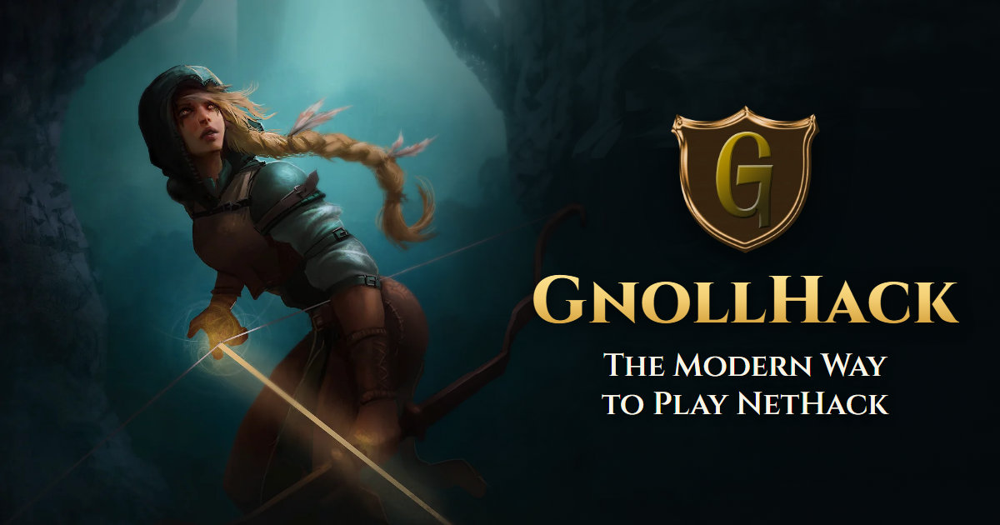

# GnollHack Marketing Website

[](https://dotnet.microsoft.com/)
[](LICENSE.txt)
[](https://gnollhack.com)



The source code of [gnollhack.com](https://gnollhack.com), the official website of [GnollHack](https://github.com/hyvanmielenpelit/GnollHack), a free and open-source modernization of NetHack by the Finnish nonprofit [Sound Mind Games](https://soundmindgames.org/).

This repository contains only the website. The game itself is in the [GnollHack repository](https://github.com/hyvanmielenpelit/GnollHack).

## Contents

- [Highlights](#highlights)
- [Technology Stack](#technology-stack)
- [Getting Started](#getting-started)
- [Project Structure](#project-structure)
- [Configuration](#configuration)
- [Styling](#styling)
- [Testing](#testing)
- [Publishing](#publishing)
- [Caching and Security Headers](#caching-and-security-headers)
- [Automation and AI Assistance](#automation-and-ai-assistance)
- [Contributing](#contributing)
- [License](#license)

## Highlights

- **Single landing page**: hero, download links, game overview, trailer and screenshot carousel, features, and community resources.
- **Responsive layout**: fluid typography and content-driven section heights, tested across viewport sizes in a real browser.
- **Privacy by default**: fonts and video posters are self-hosted, and a fresh page load requests nothing from other hosts. Google Tag Manager loads only after the visitor explicitly accepts optional cookies.
- **Search and sharing metadata**: canonical URL, OpenGraph and Twitter cards, Schema.org `VideoGame` data, `robots.txt`, and `sitemap.xml`.
- **Built for a CDN**: static assets are cached for a year at the Azure Front Door edge, while pages are revalidated on every request.

## Technology Stack

| Area | Technology |
| :--- | :--- |
| Server | ASP.NET Core 10.0 Razor Pages |
| Client | JavaScript (ES6+), jQuery 3.7.1, Bootstrap 5.3.3 |
| Styling | SCSS compiled to committed CSS |
| Fonts | Self-hosted Cinzel and Lato |
| Testing | xUnit, Playwright for .NET, `WebApplicationFactory` |
| Hosting | Windows (`win-x64`, framework-dependent) behind Azure Front Door |

## Getting Started

### Prerequisites

- [.NET 10 SDK](https://dotnet.microsoft.com/download/dotnet/10.0), at the version or later feature band set in [`global.json`](global.json)
- [Node.js](https://nodejs.org/), only for compiling SCSS from the command line

### Run Locally

```powershell
git clone https://github.com/hyvanmielenpelit/GnollHackMarketingWebsite.git
cd GnollHackMarketingWebsite
dotnet run --project GnollHackMarketingWebsite
```

Then open <http://localhost:5201>. The log warning `Failed to determine the https port for redirect` is expected on this HTTP-only profile.

To run over HTTPS at <https://localhost:7217>, trust the ASP.NET Core development certificate once and select the `https` profile:

```powershell
dotnet dev-certs https --trust
dotnet run --project GnollHackMarketingWebsite --launch-profile https
```

> [!NOTE]
> Use the `Development` environment for local runs. An unpublished `Production` run serves fingerprinted CSS and JavaScript with empty bodies.

## Project Structure

```text
GnollHackMarketingWebsite/
├── GnollHackMarketingWebsite/            Web application
│   ├── Pages/
│   │   ├── Index.cshtml                  Landing page
│   │   ├── Index.cshtml.cs               Carousel videos and images
│   │   ├── Error.cshtml                  Error page
│   │   ├── _Carousel.cshtml              Media carousel
│   │   ├── _FullscreenModal.cshtml       Fullscreen media viewer
│   │   └── Shared/_Layout.cshtml         Metadata, navigation, consent notice, footer
│   ├── wwwroot/
│   │   ├── css/                          SCSS sources and compiled CSS
│   │   ├── js/                           Site scripts and jQuery
│   │   ├── img/                          Hero art, badges, screenshots, posters
│   │   ├── fonts/                        Web fonts and their licenses
│   │   ├── lib/                          Bootstrap
│   │   └── favicon/                      Favicons and touch icons
│   ├── Program.cs                        Request pipeline and response headers
│   ├── appsettings.json                  Site configuration
│   └── compilerconfig.json               Visual Studio SCSS compilation
├── GnollHackMarketingWebsite.Tests/      CSS, browser, and HTTP header tests
├── AGENTS.md                             Project conventions
├── GnollHackMarketingWebsite.slnx        Solution
└── global.json                           .NET SDK version
```

## Configuration

Settings are in [`appsettings.json`](GnollHackMarketingWebsite/appsettings.json) and can be overridden in the usual ASP.NET Core ways, such as environment variables.

| Key | Purpose |
| :--- | :--- |
| `BaseUrl` | Public origin for canonical, OpenGraph, and Twitter URLs. It is configured rather than read from the request, because the origin runs behind a reverse proxy. |
| `GoogleTagManagerID` | Container loaded after the visitor accepts optional cookies. When it is empty, the consent notice and the Cookie Settings button are not rendered. |

## Styling

The site serves the compiled `.min.css` files, so **compiled CSS is committed alongside its SCSS source**. Compile both outputs whenever you change a `.scss` file.

| Source | Scope |
| :--- | :--- |
| `wwwroot/css/site2.scss` | Site styles |
| `wwwroot/css/carousel.scss` | Media carousel |
| `wwwroot/css/fonts.scss` | Font declarations |

In Visual Studio, the [Web Compiler 2022+](https://marketplace.visualstudio.com/items?itemName=Failwyn.WebCompiler64) extension compiles on save using `compilerconfig.json`. From the command line, run this from the repository root:

```powershell
foreach ($name in 'site2', 'carousel', 'fonts') {
    $css = "GnollHackMarketingWebsite/wwwroot/css/$name"
    npx sass "$css.scss" "$css.css" --no-source-map
    npx sass "$css.scss" "$css.min.css" --style=compressed --no-source-map
}
```

Do not generate source maps or gzip files. The CSS tests fail if they appear.

## Testing

Build once and install the Playwright browser. Repeat this after every `Microsoft.Playwright` update, or the browser tests fail at launch.

```powershell
dotnet build GnollHackMarketingWebsite.slnx
powershell -NoProfile -ExecutionPolicy Bypass -File GnollHackMarketingWebsite.Tests\bin\Debug\net10.0\playwright.ps1 install chromium
```

Then run the whole suite:

```powershell
dotnet test GnollHackMarketingWebsite.slnx
```

| Layer | Test Classes | Covers |
| :--- | :--- | :--- |
| CSS | `CssSpecificationTests` | Compiled CSS rules, minified output, and forbidden build artifacts |
| Browser | `ResponsiveLayoutTests`, `HeroTests`, `CarouselTests`, `ContentSectionTests`, `CookieConsentTests`, `ExternalRequestTests` | Layout, rendering, interaction, consent, and external requests in headless Chromium |
| HTTP | `ResponseHeaderTests` | Cache and security headers |

Browser and header tests run against the real `Program.cs` in the `Development` environment, so the exception handler and HSTS branch used in other environments is not covered.

## Publishing

```powershell
dotnet publish GnollHackMarketingWebsite\GnollHackMarketingWebsite.csproj -c Release -r win-x64 --self-contained false -o GnollHackMarketingWebsite\bin\Release\net10.0\publish\win-x64
```

The project file keeps SCSS sources, source maps, and `compilerconfig.*` out of the publish output. Upload only that output to the server.

The Visual Studio `FolderProfile` publish profile uses the same settings, but `*.pubxml` files are gitignored, so it exists only on machines where it has been created.

## Caching and Security Headers

The site runs behind Azure Front Door. The header middleware in [`Program.cs`](GnollHackMarketingWebsite/Program.cs) sets the following `Cache-Control` values, and it must stay ahead of `UseRouting`, `MapStaticAssets`, and `MapRazorPages`.

| Paths | `Cache-Control` |
| :--- | :--- |
| `/css`, `/js`, `/img`, `/fonts`, `/lib`, `/favicon`, `/site.webmanifest`, `/robots.txt`, `/sitemap.xml` | `public,max-age=31536000,immutable` |
| `/`, `/Error` | `no-cache` |

Because these files are cached for a year, a changed image needs a new file name. Stylesheets and site scripts are cache-busted with `asp-append-version`.

The middleware also sets `X-Content-Type-Options`, `X-Frame-Options`, `Referrer-Policy`, and `Permissions-Policy` on every response.

## Automation and AI Assistance

AI models have assisted with this website:

| Model | Used For |
| :--- | :--- |
| Gemini 4 Argon | Graphical work for the November 2026 facelift |
| Claude Opus 5.5 | Coding and polishing |

This applies to the website only. For the game's assets, see the [GnollHack README](https://github.com/hyvanmielenpelit/GnollHack#readme).

AI agents follow the project conventions in [`AGENTS.md`](AGENTS.md) and the guide in [`.agents/skills/gnollhack-website-guide`](.agents/skills/gnollhack-website-guide/SKILL.md). They never commit or push on their own: changes stay in the working tree for the developer to review, and a commit or push needs the developer's explicit permission.

The [automated tests](#testing) run on demand with `dotnet test`. The repository has no continuous integration workflows.

## Contributing

- Report website problems in this repository's [issues](https://github.com/hyvanmielenpelit/GnollHackMarketingWebsite/issues), and game problems in the [GnollHack repository](https://github.com/hyvanmielenpelit/GnollHack/issues) or on [Discord](https://discord.gg/cQuExnzUQy).
- Read [`AGENTS.md`](AGENTS.md) before changing the site. It records the conventions for images, typography, caching, and cookie consent.
- Run `dotnet test GnollHackMarketingWebsite.slnx` before committing a change.

## License

The website's source code is licensed under the [MIT License](LICENSE.txt). The MIT License does not cover the images in `wwwroot/img` and `wwwroot/favicon`:

- Graphics from the GnollHack game, such as sprites and screenshots, are licensed under [CC BY-NC 4.0](https://creativecommons.org/licenses/by-nc/4.0/), as stated in the [GnollHack README](https://github.com/hyvanmielenpelit/GnollHack#readme).
- No license is granted for the other images, including the GnollHack logo and the website's hero and background art.

Bundled third-party components keep their own licenses:

| Component | License |
| :--- | :--- |
| [Bootstrap](https://getbootstrap.com/) | [MIT](https://github.com/twbs/bootstrap/blob/main/LICENSE) |
| [jQuery](https://jquery.com/) | [MIT](https://jquery.org/license/) |
| Cinzel | [SIL Open Font License](GnollHackMarketingWebsite/wwwroot/fonts/Cinzel-OFL.txt) |
| Lato | [SIL Open Font License](GnollHackMarketingWebsite/wwwroot/fonts/Lato-OFL.txt) |

Google Play, App Store, and Steam names and badges are trademarks of their respective owners.
